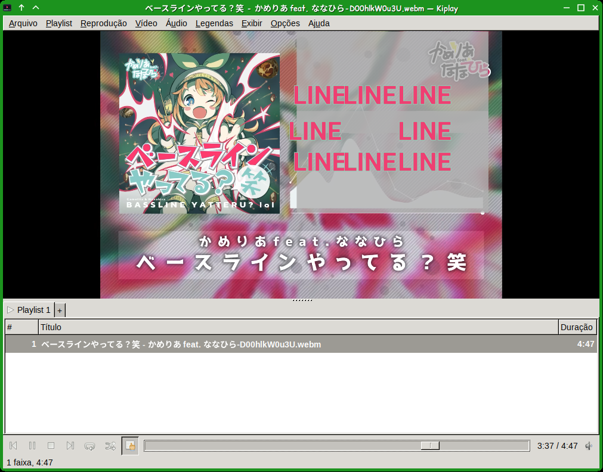
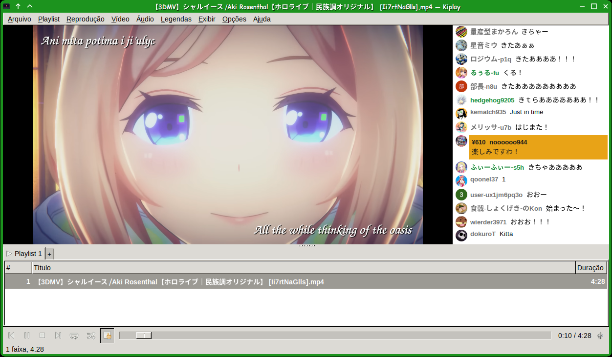
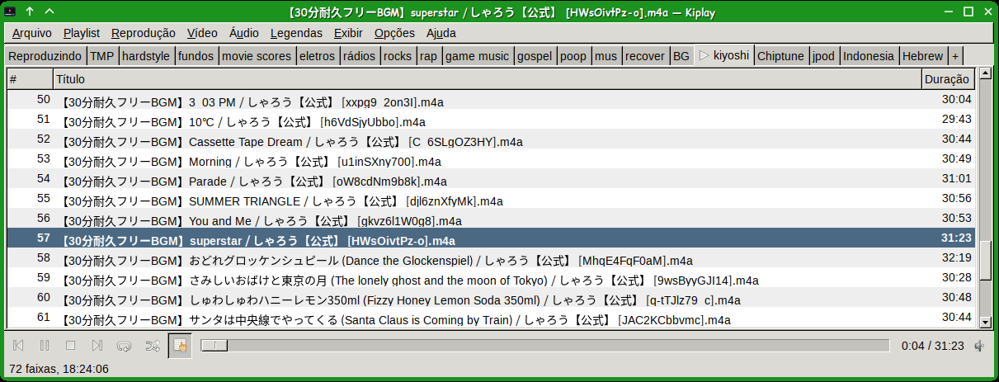

# Kiplay

**English** · [Português](README.pt-BR.md)

A lightweight audio and video player for KiDesktop, in C + GTK2. It
combines Audacious's tabbed playlists with SMPlayer's configurability,
plays video through an external program (mpv or MPlayer) and music through
its own small engine.

What sets it apart: showing what yt-dlp downloads alongside a video as
close to the original as possible:

- YouTube captions with their styling, positioning and animation
  (srv3/json3);
- recorded live chat (`live_chat.json`), beside the video or flying across
  it (danmaku);
- ordinary subtitles (srt, ass, vtt...).

<p align="center">
  
  
</p>
<p align="center">
  
</p>

**Status:** in development, phase 6: already an everyday player (video
through mpv, music through its own `kiplay-audio` engine with gapless and
NSF/SPC/GBS/VGM game music, Master System FM included, with the names and
lengths from the `.m3u` beside it, and MIDI with a SoundFont of your choice; tabbed playlists with tags, a play queue,
search, drag to reorder, m3u/pls import and export; configurable layout;
tabbed preferences, editable shortcuts, resume where it stopped, audio
and subtitle tracks, MPRIS, tray icon, compact mode; YouTube captions with
their style and position, as on the site; recorded live chat in a panel
beside the video). Chat as danmaku doesn't exist yet. See
the [plan](PLANO.md) and the [comparison with Audacious](docs/BENCH.md)
(both in Portuguese).

## Install

Download the `.deb` for your distro from the
[Releases page](https://github.com/kiyoshispreclerg/kiplay/releases)
(available for Ubuntu 22.04 and 24.04, and Devuan daedalus and excalibur;
amd64) and install it with `apt`, which pulls in the libraries it needs,
plus `mpv` and `curl` (recommended packages; video needs mpv or MPlayer,
music plays without them):

```sh
sudo apt install ./kiplay_<version>-1_<distro>_amd64.deb
```

To download YouTube subtitles, point `[tools] ytdlp` at a yt-dlp binary
(see Usage). Uninstall with `sudo apt remove kiplay`.

## Usage

```sh
kiplay                      # opens the window
kiplay video.mkv song.mp3   # adds to the playlist on screen and plays the first
kiplay ~/Music/Album        # folders go in whole, by name
kiplay -e *.mp3             # only adds (enqueues)
kiplay -n ~/Music/Album     # into a new playlist (new tab)
```

With Kiplay open, `kiplay FILE` sends the file to the existing window.
After `make install` it shows up in "Open with" for audio and video types,
and the file manager menu gets "Add to Kiplay playlist" (the current one,
without playing) and "Add to new Kiplay playlist", the latter for folders
too.

| Key | Does |
|---|---|
| Space, media key | play / pause |
| ← / → | back / forward 5 s (Shift: 1 min) |
| Ctrl+← / Ctrl+→, < / > | previous / next track |
| + / −, M | volume, mute |
| F, F11, double click on the video | fullscreen (Esc leaves; the control bar shows when the mouse moves near its edge, at the bottom or top) |
| Ctrl+C | compact mode: only the video and the controls |
| Ctrl+L | show/hide the playlists (also the button on the control bar) |
| # , J, V | next audio track, next subtitle, show/hide subtitles |
| Ctrl++ / Ctrl+−, X / Z | audio delay, subtitle delay (100 ms) |
| A | next aspect ratio (4:3, 16:9...) |
| Enter, double click on the list | plays the track |
| Del | removes from the playlist |
| Q | queues (or unqueues); the queue plays before the rest |
| Ctrl+X, Ctrl+Ins, Ctrl+V | cut, copy and paste files in the playlist (Shift+Del and Shift+Ins too) |
| Ctrl+J | jump to file: search the playlist on screen |
| Ctrl+F | search panel beside the playlists: tracks of all playlists; double click plays and shows its tab; Esc closes |
| Ctrl+M, Ctrl+R, Ctrl+S | stop after this track, repeat, shuffle |
| Alt+↑ / Alt+↓, drag | moves the selected tracks |
| Ctrl+O, Ctrl+Shift+O | add files, add folder |
| Ctrl+T, F2, Ctrl+W | new playlist, properties (name, type), close |
| Ctrl+P | preferences |
| Alt+1..9 | goes to that playlist |

Shortcuts are changed in Options → Preferences → Shortcuts (up to two
keys per command). A right click on the video or the control bar opens a
menu with the essentials (handy in compact mode and fullscreen), including the audio and subtitle tracks of the video. A right click on a playlist row: play, queue, cut/copy/paste, remove and open the file's folder.

**YouTube subtitles:** if a video's name ends with its ID in square brackets
(`Title [dQw4w9WgXcQ].mp4`, as yt-dlp writes it), the Subtitles menu and the
right click on the video offer "Download subtitles from YouTube...": Kiplay
asks yt-dlp whether the video exists and which languages it has (the uploaded
ones and the automatic captions in the video's language), downloads the chosen
ones next to the file (in the styled format) and loads them at once. The
yt-dlp path is in Options → Preferences → Advanced (`[tools] ytdlp`).

Kiplay remembers, for each video, where it stopped, the audio and
subtitle tracks chosen, the delays and the aspect ratio (in
`~/.local/share/kiplay/files/`), and goes on from there next time.
Preferences → General extends this to music or turns it off.

The columns (number, queue position, artist, album, length, path) are under View →
Playlist columns. Tags are read in the background, in a separate process,
and kept in the playlist.

A playlist's type (right-click its tab → Properties, or F2) is "Mixed" or
"Audio only". In an audio-only playlist everything plays on the light
music engine, videos too (just their sound: a few MB of memory and almost
no CPU, even for a big file), and a video you open while it is the current
playlist goes to the next mixed playlist (a new one if there is none).

Kiplay shows up to the desktop through MPRIS (media keys, applets,
kikarinhas) and can have a tray icon.

Settings live in `~/.config/kiplay/kiplay.ini`, which the preferences
dialog writes and which can also be edited by hand (comments are kept;
only what differs from the default is written):

```ini
[mpv]
# the program, or its full path
program = mpv
# true: also reads your ~/.config/mpv/mpv.conf
use_config = false
# extra options, as in SMPlayer
extra = --deband

[tools]
# yt-dlp (the Linux binary), to download YouTube subtitles; empty: looked up in PATH
ytdlp = ~/Downloads/yt-dlp_linux

[video]
hwdec = auto-safe

[subtitles]
languages = pt-BR,pt,en
font_size = 48

[playback]
# auto: music on kiplay-audio (light, gapless); mpv: everything on mpv
engine = auto
# kiplay-audio's output: default (PulseAudio/PipeWire, or ALSA when there's
# no server) or an ALSA device (hw:0, null...)
device = default

[files]
# off, video or all: resume where it stopped
resume = video

[shortcuts]
# keys in GTK's format; empty: none
next = <Control>Right,greater
mute =
```

(Comments only on lines of their own: after a value, the `#` would be
part of it.)

To download a video with captions in the right format:

```sh
yt-dlp --write-subs --sub-langs all,live_chat --sub-format srv3/json3/best URL
```

yt-dlp's default format is vtt, which loses positions, colors and sizes.

Kiplay finds the files next to the video by name (`Title [ID].mp4` →
`Title [ID].ko.srv3`, `.json3`, `.vtt`, `.srt`, `.ass`...). For each
language the srv3 (or json3) wins over the plain ones: it is converted to
ASS (in `~/.cache/kiplay/subs`) and shows in the Subtitles menu as "YouTube
style". The language is picked from the `[subtitles] languages` list. To
convert by hand, for another player:

```sh
kiplay --convert "Title [ID].ko.srv3" > ko.ass
```

The recorded chat (`Title [ID].live_chat.json`, which yt-dlp saves with
`--sub-langs live_chat`) shows in a panel beside the video, following the
video's time and starting over at every seek: messages with the channel's
emoji and avatars (downloaded once with `curl` into `~/.cache/kiplay/chat`, with a clear-cache button in Preferences → Chat),
Super Chats and new members as colored cards, names in gold/blue/green for
the channel, moderators and members. View → Chat (key `c`; in fullscreen mpv itself draws the chat right of the video); Preferences →
Chat: width and a filter ("Super Chats and members only").

In `[subtitles]`, `youtube_edge = strong` swaps YouTube's thin outline for a
thick, blurred one that is easier to read; `auto = no` turns the search off.

## Build

Needs GTK 2, GLib, ALSA, zlib, a C++ compiler and the FFmpeg
libraries (libavformat, libavcodec, libswresample), with their `-dev`
packages. libpulse (`libpulse-dev`) is optional but recommended: `make` uses
it when the headers are found; otherwise it prints a note and builds with
ALSA only (`make PULSE=0` forces that, `make PULSE=1` requires PulseAudio). Game music
uses a copy of [Game_Music_Emu](https://github.com/libgme/game-music-emu)
in `vendor/gme` (LGPL-2.1-or-later). MIDI uses
[TinySoundFont and TinyMidiLoader](https://github.com/schellingb/TinySoundFont)
in `vendor/tsf` (MIT and zlib) and needs a General MIDI SoundFont (`.sf2`):
set the file in Options → Preferences → Audio; empty, the first one found in
`/usr/share/sounds/sf2` is used (the small TimGM6mb before the others). It is
kept in memory, at twice the file's size, only while a MIDI plays. There is
no reverb or chorus.

```sh
make
make test
make run             # runs from build/, with the translations
sudo make install    # into /usr/local
```

## License

GPL-3.0-or-later.
